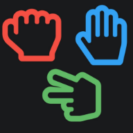

<p align="center"><a href="#"></a></p> 
<h2 align="center"><b>Rock Paper Scissor</b></h2>
<h4 align="center">No Server, No Storage, Just Peer to Peer</h4>

<p align="center"><a href="https://silly-fermat-36c0e6.netlify.app">Play Now</a></p>

## Description

This is a peer to peer game built on top of [p2p](https://github.com/subins2000/p2pt) library

### Project setup

```
npm install
```

#### Starts the dev server with hot reload

```
npm run dev
```

#### Compiles and minifies for production

```
npm run build
```

#### Lints and fixes files

```
npm run lint
```

#### Customize configuration

See [Vite Configuration Reference](https://vite.dev/config/) and `vite.config.js`.
